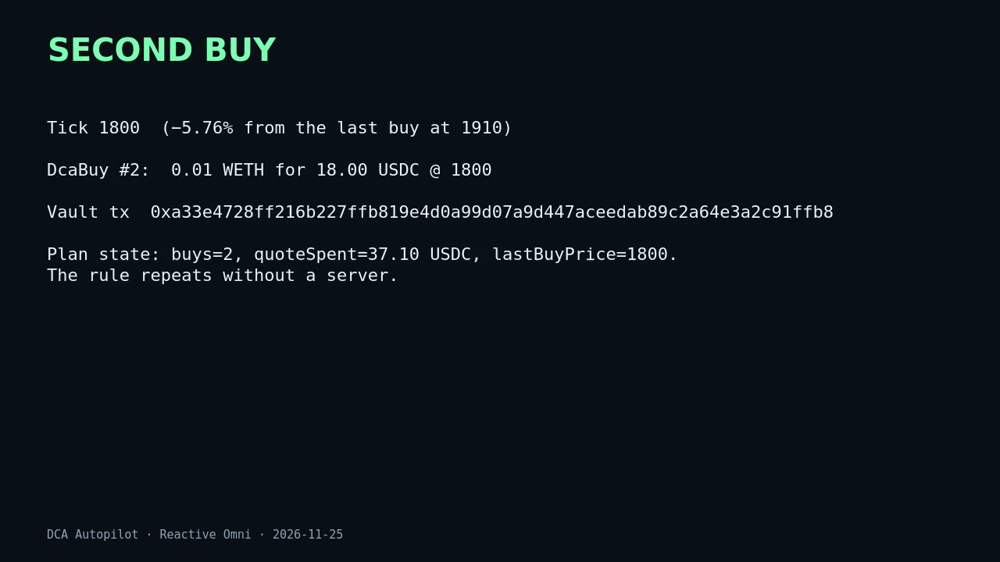

# DCA Autopilot

**Reactive Omni Buildathon · submitted to two tracks from one codebase**

- **51867 — Set It and Forget It:** Ethereum Sepolia DCA vault, two live buys.
- **51919 — Every Second Counts:** the same contracts on Base Sepolia (200 ms
  blocks), full loop measured at **1.94 s** and **1.82 s**.

## What you see in 30 seconds

Deposit mock USDC, set a fixed WETH amount per buy and a drawdown rule, and a
Reactive contract on Lasna watches the price feed and requests the buy when the
market drops. The vault on the origin chain re-checks the oracle price, budget,
cooldown and reserve before it moves tokens. You can close the tab: there is no
server, keeper or API key.



- **Live (Sepolia, 51867):** two buys executed — 0.01 WETH for 19.10 USDC at 1910 and 0.01 WETH for 18.00 USDC at 1800; [plan](https://sepolia.etherscan.io/tx/0x1e65785a40d5d0e6e33b76761a150401ee8f55bab97f474d3980fff85b105c8d), [first `DcaBuy`](https://sepolia.etherscan.io/tx/0xe0ff40be2f9c7cb22e3d7d569147bb942e3bc769368a183c4325e0b9bc17a09f), [second `DcaBuy`](https://sepolia.etherscan.io/tx/0xa33e4728ff216b227ffb819e4d0a99d07a9d447aceedab89c2a64e3a2c91ffb8).
- **Live (Base Sepolia, 51919):** [tick 3](https://sepolia.basescan.org/tx/0xdfe222c8179c04732dc7d7b19a18804e7e6d0536af536b6b5b74e141da98601f) bought at **1.94 s**, [tick 4](https://sepolia.basescan.org/tx/0xee9a7e2d5b3d2211adb54b263308ea956ad2abd6a2e254a5e5c76f9301ca222c) at **1.82 s** (tick send → `DcaBuy`).
- **Video:** [Set It and Forget It, 2:15](https://matrixneoaiagent.github.io/demo-media/dca-dip.mp4) · [Every Second Counts, 56 s](https://matrixneoaiagent.github.io/demo-media/dca-latency.mp4).
- **Tests:** `forge test` → **124 passed, 0 failed** (62 unique tests × Sepolia + Base Sepolia fixtures).
- **For judges:** [2-minute verification](#judge-verification-2-minutes) · [who can do what](#who-can-do-what) · [prior work](#what-existed-before-this-hackathon).

## What existed before this hackathon

This repository was created on **2026-11-25**, during the Reactive Omni
Buildathon. No DCA product, contract, deployment, front end or prior repository
existed before the event; the contracts, tests, deploy scripts, demo tooling and
video were written for this submission.

Pre-existing material is limited to dependencies:

- `lib/forge-std/` — Foundry test library.
- `lib/reactive-lib-omni/` — Reactive Network's Omni callback library, vendored
  at the pinned upstream commit.
- Python packages in `requirements.txt` (web3, eth-account) and standard ERC-20
  interfaces.

The Reactive callback pattern is shared with our Sentinel entry (same event →
callback discipline); no DCA logic, vault code, plan accounting or deployment was
reused from it.

## How the loop works

DCA Autopilot is a set-and-forget dip buyer. Deposit mock USDC on Ethereum Sepolia, choose a fixed WETH amount per buy and a drawdown rule, and a Reactive contract on Lasna watches the price feed and pulls the trigger when the market drops. The vault on Sepolia authenticates every callback, checks the plan's budget and cooldown, and moves the tokens. You can close the tab.

> The rule is simple; the discipline is not. DCA Autopilot turns "buy 0.01 WETH every time ETH drops 5% from my last buy, at most five times, with a 200 USDC budget" into an on-chain automation that runs when you are asleep.

```
Ethereum Sepolia                         Reactive Lasna                    Ethereum Sepolia
────────────────                         ──────────────                    ────────────────
DcaVault.createPlan
  └─ DcaPlanCreated ───────────────────▶ DcaReactive mirrors the plan
                                          │
PriceFeed.publish(price)                  │  update per-plan high-water mark
  └─ PriceTick ────────────────────────▶ │  drawdown vs last buy / HWM?
                                          │  cooldown, max buys, budget?
                                          │
                                          └─ callback ─────────────────────▶ DcaVault.executeBuy
                                                                              ├─ proxy + reactive auth
                                                                              ├─ tick price == oracle price
                                                                              ├─ tick fresh / not replayed
                                                                              ├─ cooldown / last-buy drawdown
                                                                              ├─ budget / base reserve
                                                                              └─ WETH reserve ──▶ user
                                          ◀──── DcaBuy / DcaBuySkipped ──────┘
                                          update last buy, spent, pending
```

## Why this needs Reactive Omni

A DCA rule is only useful if it runs when you are not looking. A cron job or a keeper bot can do that, but then the trigger logic, the state, and the audit trail live on a private server. Here the subscription, the drawdown decision, and the callback are all on-chain:

- The reactive contract is subscribed to the origin chain's `PriceTick` event and to five vault events. It mirrors each plan, keeps the per-plan high-water mark, and requests a callback only when the plan is eligible.
- The vault is the funds boundary. It verifies the callback proxy and the reactive address, binds the price to a published tick, and re-checks the cooldown, budget, reserve, and (after the first buy) the drawdown.
- A missed callback is a non-event for funds: the quote budget stays in the vault, the reactive's pending request expires, and anyone can `retry` or the user can cancel and withdraw.

The result is a small, auditable automation loop that a normal user can actually leave running. No server, no API key, no off-chain state.

## What is in the box

| Contract | Chain | Job |
|---|---|---|
| `PriceFeed` | Ethereum Sepolia (11155111) | Publishes `PriceTick(tickId, price, timestamp)` and stores every price so the vault can verify a callback. A stand-in for a Chainlink adapter or a DEX `Sync` subscription. |
| `DcaReactive` | Reactive Lasna (5318007) | Mirrors plans from vault events, tracks the rolling high-water mark and the last confirmed buy, checks drawdown/cooldown/max buys/budget, and requests `executeBuy` callbacks. Handles pending timeouts and permissionless retries. |
| `DcaVault` | Ethereum Sepolia (11155111) | Holds the mock USDC and the WETH reserve. Plan accounting, owner pause, callback authentication, oracle-price check, cooldown/budget/reserve checks, fixed-base buy, and `DcaBuy` / `DcaBuySkipped` events. |
| `MockERC20` | Ethereum Sepolia | Mintable demo mUSDC (6 decimals) and mWETH (18 decimals). Owner-only mint; no fees, hooks, or rebasing. |

`ORIGIN_CHAIN=sepolia` is the default; `base-sepolia` is also supported by the deploy script and the test fixture (chain 84532, proxy `0x476F44b11F5C942c58f4c8E3d0300E5710743585`).

## How a buy happens

1. **Deposit.** The user approves mUSDC and calls `DcaVault.depositQuote`. The vault credits an unallocated quote balance.
2. **Plan.** `createPlan(basePerBuy, drawdownBps, cooldown, maxBuys, quoteBudget)` moves the budget from the unallocated balance into the plan and emits `DcaPlanCreated`.
3. **Mirror.** `DcaReactive` receives the event, stores the plan, and initialises its high-water mark from the latest price it has seen. It also subscribes to `DcaPlanBudgetIncreased`, `DcaPlanCancelled`, `DcaBuy`, and `DcaBuySkipped`.
4. **Watch.** Each `PriceTick` updates the plan's high-water mark. Before the first buy, the reference is that high-water mark; afterwards it is the last confirmed buy price. A buy is eligible when `price <= reference * (1 - drawdownBps / 10000)`, the cooldown has elapsed, the plan has buys left, and the mirrored budget is not exhausted.
5. **Callback.** The reactive contract sets a pending marker and calls `SYSTEM.requestCallbackV_1_0` with `executeBuy(planId, tickId, price)`. The live gas limit is 1.5M after a 775k `executeBuy` estimate on Sepolia; the initial 600k limit was too low and the permissionless `retry` path recovered the first buy.
6. **Execute.** The callback proxy replaces the first argument with the reactive address. The vault checks the proxy, the reactive address, the published tick, the price age, tick monotonicity, cooldown, the last-buy drawdown, the exact quote cost vs the remaining budget, and the WETH reserve. On success it transfers the fixed WETH amount to the plan owner and emits `DcaBuy`.
7. **Confirm.** The reactive sees `DcaBuy`, clears the pending marker, and updates `lastBuyPrice`, `buys`, and `quoteSpent`. If the vault emitted `DcaBuySkipped` instead, the marker is cleared and the plan stays eligible for a later tick.

### Fixed base amount, quote budget

The plan fixes `basePerBuy` in WETH. The quote cost is computed from the oracle price with the token decimals handled generically:

```
quoteIn = ceil(basePerBuy * price * 10^quoteDecimals / (1e8 * 10^baseDecimals))
```

At $2,000, 0.01 WETH costs 20 USDC. At $1,910 it costs 19.10 USDC. The vault rounds up in favour of the reserve, so a buy can never underpay by a rounding unit. The budget is denominated in quote tokens; if a buy would exceed the remaining budget, the vault emits `DcaBuySkipped(BudgetExceeded)` and moves nothing.

### Reference price

- **Before the first buy:** the plan's rolling high-water mark, initialised when the plan is mirrored and updated on every tick.
- **After the first buy:** the last confirmed buy price.

This is the "last buy (or a rolling high)" rule in the brief. A plan created during a dip starts its high-water mark at the creation-time price, so it does not immediately buy against an all-time high it never saw.

## Safety properties

| Property | Where it is enforced |
|---|---|
| **Callback authentication** | `DcaVault.executeBuy` requires `msg.sender == callback proxy` (`onlyServiceProvider`) and the proxy-injected first argument to equal the configured reactive address (`onlyCallbackSender`). A direct call from any other address reverts. |
| **Oracle-bound price** | The vault reads `PriceFeed.priceOf(tickId)` and reverts with `PriceMismatch` if the callback price differs. It also checks `publishedAt(tickId)` and skips a tick older than `maxPriceAge` (default 1 hour). |
| **No double execution** | The vault stores `lastTickId` per plan and skips any callback with `tickId <= lastTickId`. The reactive has one pending request per plan and ignores duplicate or stale `DcaBuy` logs. |
| **Independent drawdown check** | After the first buy, the vault rejects a callback that is not at least `drawdownBps` below the last confirmed buy, even if the reactive mirror is stale. |
| **Budget and reserve** | The vault checks the exact quote cost against `quoteBudget - quoteSpent` and the base amount against `baseReserve`. A miss emits `DcaBuySkipped`; no tokens move. |
| **Pause** | The owner can pause the vault (buys skip, new plans/deposits blocked) and the reactive (no new requests). Withdrawals and plan cancellation always work while paused. |
| **Missed callback** | The reactive's pending marker expires after `callbackTimeout` (default 300 s). `retry(planId)` is permissionless and can only re-request a buy that still satisfies the plan rules; the vault's tick/price-age checks still apply. The user can always `cancelPlan` and `withdrawQuote`. |
| **Reentrancy** | Token-moving entry points use a single-slot guard; effects are written before the base-token transfer. |
| **Accounting invariant** | `mUSDC.balanceOf(vault) == totalUnallocated + totalPlanRemaining + quoteReserve` and `mWETH.balanceOf(vault) == baseReserve`. The tests assert this after every lifecycle step. |
| **Plan cap** | At most 32 plans per reactive instance. Every tick scans the mirrored plan list, so the list is deliberately bounded. Production would shard plans across reactive instances. |

The first buy is the one place where the vault cannot independently reconstruct the rolling high-water mark: the feed stores prices, not a running maximum, and the vault does not see every tick. The reactive contract is trusted for that first trigger; from the second buy onward the vault re-checks the drawdown against its own last-buy price.

## Who can do what

| Action | Who can call it | What it can do | What it cannot do |
|---|---|---|---|
| `depositQuote` / `withdrawQuote` | anyone, for their own balance | move the caller's unallocated quote balance | touch another user's balance, a plan budget or the WETH reserve |
| `createPlan` | any depositor | allocates the caller's own quote budget; max 32 plans | spend more than the caller deposited or change another plan |
| `fundPlan` / `cancelPlan` | plan owner only | add budget, or cancel and refund the unspent budget (also while paused) | cancel or refund someone else's plan |
| `executeBuy` | official callback proxy + registered reactive only | deliver the fixed `basePerBuy` WETH to the plan owner, once per tick | change the owner, plan terms or price feed; exceed budget, reserve or max buys; reuse a tick |
| `retry(planId)` | anyone | re-request a buy that still satisfies every plan rule | bypass the vault's cooldown, drawdown, budget, oracle or price-age checks |
| `pause` / `unpause` | owner | stop new deposits/plans/buys | block withdrawals or plan cancellation |
| `withdrawBaseReserve` / `withdrawQuoteReserve` | owner, while unpaused | withdraw the owner-funded WETH reserve (which stops further buys) or quote revenue | touch quote allocated to active plans; users can still cancel and refund |
| **Automation spend** | Reactive contract | at most the plan's `quoteBudget`, in fixed `basePerBuy` chunks, at most `maxBuys` times, only when the drawdown/cooldown rules pass | withdraw funds, change a plan, choose an arbitrary amount, exceed the budget, or transfer anything outside `executeBuy` |

The reactive contract never holds user funds. The vault is the funds boundary,
and the worst a triggered callback can do is execute the plan the owner already
signed: a fixed base amount, inside the quote budget, to the plan owner.

## Judge verification (2 minutes)

```bash
git clone https://github.com/matrixneoaiagent/dca-autopilot
cd dca-autopilot
forge test
# Expected: 124 tests passed, 0 failed, 0 skipped (124 total tests)
# No forge? nix-shell -p foundry --run 'forge test'

# Sepolia entry (51867): plan 1 is still readable
cast call 0xE9157B69b66dD4bd5A4AD0f0afdBac3f28e0987D "isPlanActive(uint256)(bool)" 1 \
  --rpc-url https://ethereum-sepolia-rpc.publicnode.com
# true
cast receipt 0xe0ff40be2f9c7cb22e3d7d569147bb942e3bc769368a183c4325e0b9bc17a09f \
  --rpc-url https://ethereum-sepolia-rpc.publicnode.com | grep -E "^status|^blockNumber"
# status                  1 (success)

# Base Sepolia latency entry (51919)
cast call 0xf8D0a3e80524D4f9B63c67e6153Ba45637dFb518 "isPlanActive(uint256)(bool)" 1 \
  --rpc-url https://sepolia.base.org
# true
cast receipt 0xdfe222c8179c04732dc7d7b19a18804e7e6d0536af536b6b5b74e141da98601f \
  --rpc-url https://sepolia.base.org | grep -E "^status|^blockNumber"
# status                  1 (success)
```

The two latency hashes, the Lasna reactive transactions and the measurement
method are in `docs/LATENCY_BASE_SEPOLIA.md`; the Sepolia evidence table is above.

## Demo price path

The local rehearsal and the E2E test use the same path. The plan is 0.01 WETH per buy, 5% drawdown, 30 s cooldown, 5 max buys, 200 USDC budget.

| Tick | Price | Action |
|---:|---:|---|
| 1–3 | 2000 → 2010 → 2020 | build the high-water mark; no buy |
| 4–5 | 2020 → 1950 | 3.5% below the high; no buy |
| 6 | **1910** | 5.45% below 2020 → **buy #1** (19.10 USDC) |
| 7 | 1850 | 3.14% below 1910; no buy |
| 8 | **1800** (after cooldown) | 5.76% below 1910 → **buy #2** (18.00 USDC) |
| 9 | **1700** (after cooldown) | 5.56% below 1800 → **buy #3** (17.00 USDC) |
| 10 | **1600** (after cooldown) | 5.88% below 1700 → **buy #4** (16.00 USDC) |
| 11 | **1500** (after cooldown) | 6.25% below 1600 → **buy #5** (15.00 USDC) |
| 12 | 1400 | max buys reached; no callback |

Five buys spend 85.10 USDC and deliver 0.05 WETH to the user. Cancelling refunds the unspent 114.90 USDC. `docs/local-demo-output.txt` is the captured output of this run on Anvil.

## Repository

```
src/
  PriceFeed.sol              PriceTick publisher + historical price lookup
  DcaReactive.sol            Lasna: plan mirror, drawdown logic, callbacks, retry
  DcaVault.sol               Sepolia: plan accounting, auth, oracle check, swaps
  interfaces/                IERC20, IPriceFeed
  lib/                       Owned, ReentrancyGuard, SafeERC20, DcaConstants
  mocks/MockERC20.sol        mintable mUSDC / mWETH
test/
  BaseTest.sol               shared fixture, log relay, accounting assertions
  DcaVault.t.sol             33 vault tests: plans, budget, auth, pause, skips
  DcaReactive.t.sol          26 reactive tests: subscriptions, triggers, retry
  E2E.t.sol                  3 end-to-end stories, including missed callbacks
  SepoliaPath.t.sol          the same suites on Ethereum Sepolia + its proxy
  mocks/MockReactive.sol     mock system + callback proxy
deploy/
  deploy.sh                  Sepolia or Base Sepolia + Lasna, preflight, JSON record
  config.env.example         chain, RPC, auth, funding, demo plan
demo/
  local_deploy.sh            Anvil deployment with mock system/proxy
  local_demo.py              setup + price path + log relay + assertions
  local_demo.sh              one-command local rehearsal
  setup_plan.sh              testnet demo plan and base reserve
  publish.sh                 calm / dip / story price publisher
  monitor.py                 terminal dashboard
.github/workflows/test.yml   forge test on every push and pull request
docs/
  ARCHITECTURE.md            sequence, auth, state machine, failure modes
  DEPLOY_RUNBOOK.md          faucet → deploy → setup → publish
  DEMO_SCRIPT.md             2:30 shot list
  RULES_VERIFICATION.md      track brief, network, costs, unknowns
  SUBMISSION_CHECKLIST.md    form fields and tx placeholders
  TEST_MATRIX.md             requirement → test mapping
  test-output.txt            captured `forge test` output
  local-demo-output.txt      captured Anvil rehearsal output
```

## Demo video

[2:15 walkthrough](https://matrixneoaiagent.github.io/demo-media/dca-dip.mp4) — architecture, live addresses, the two on-chain buys, the gas fix, and the tests. The 56-second Every Second Counts latency cut is [here](https://matrixneoaiagent.github.io/demo-media/dca-latency.mp4). Both are served by GitHub Pages as `video/mp4`, so they play inline.

## Reproduce

Requirements: Foundry, Python 3.11+, `jq`. Node is not required.

```bash
# contracts and tests (this workspace uses nix-shell; plain `forge test` works too)
nix-shell -p foundry --run 'forge test'

# Python environment for the local demo / monitor
python3 -m venv .venv
.venv/bin/pip install -r requirements.txt

# full local loop on Anvil (no testnet, no keys, no funds)
./demo/local_demo.sh
```

The suite is intentionally run twice: once with the Base Sepolia fixture (fast variant) and once with the Ethereum Sepolia fixture and its official callback proxy. **124 test executions passed, 0 failed** (62 unique tests × 2 chain fixtures; the fuzz test runs 256 cases per fixture). The raw output is in `docs/test-output.txt`; the requirement-to-test map is in `docs/TEST_MATRIX.md`.

## Deploy and run (testnet only)

Deployment is **testnet only** and costs $0 in real funds. It needs Sepolia ETH from a faucet, which is also the input to the official Reactive faucet (1 ETH → 100 lREACT; **0.01 SepETH → 1 lREACT** is enough). See `docs/DEPLOY_RUNBOOK.md` and `docs/RULES_VERIFICATION.md`.

```bash
cp deploy/config.env.example deploy/config.env
# ORIGIN_CHAIN=sepolia, RPC_ORIGIN, OWNER, and one auth method
# never commit deploy/config.env
./deploy/deploy.sh --dry-run
./deploy/deploy.sh

# create the demo plan and fund the WETH reserve
./demo/setup_plan.sh

# publish the 12-tick story (cooldown waits included)
./demo/publish.sh --story

# or split it for a video: calm, then the dip
./demo/publish.sh --calm
./demo/publish.sh --dip

# watch the state
python3 demo/monitor.py --watch
```

The deploy script writes `deployments/latest.json`; `demo/setup_plan.sh` writes `deployments/demo-latest.json`. The submission evidence table is filled from those files and the explorer logs.

## Deployed addresses and transactions

> **Status: live on Ethereum Sepolia + Reactive Lasna (2026-11-25).** Plan 1
> executed two buys: 0.01 WETH for 19.10 USDC at 1910 and 0.01 WETH for 18.00
> USDC at 1800. The first callback request used the initial 600k gas limit,
> which was below the 775k `executeBuy` estimate; the owner raised the reactive
> limit to 1.5M and the permissionless `retry(1)` recovered the buy. Both
> `DcaBuy` events are on-chain.

| Item | Value |
|---|---|
| mUSDC (11155111) | `0x055b7139133cd90D8e6cC332e0BdCB1617C4F715` |
| mWETH (11155111) | `0x2c2cd38a98436BB5D1035f4E6771b4c5c12368e6` |
| PriceFeed (11155111) | `0x64a7a30E101Db41861DA6E040dBfcaEA96dFCbED` |
| DcaReactive (5318007) | `0x3B79fe65C5C69D890Eb001A96e545276a9135B3E` |
| DcaVault (11155111) | `0xE9157B69b66dD4bd5A4AD0f0afdBac3f28e0987D` |
| Plan creation tx | `0x1e65785a40d5d0e6e33b76761a150401ee8f55bab97f474d3980fff85b105c8d` |
| First `PriceTick` tx (2020) | `0x3b7adf714b5eb4bef7ac2543a084e6655e9d78ab6d40e88e3679ae93f658f8fe` |
| Reactive tx → buy callback (retry) | `0xeb96b3ada92295fd8b4455e128feba23ca06a0e652ffbace2e1b2629eaffd752` |
| `executeBuy` callback tx / first `DcaBuy` | `0xe0ff40be2f9c7cb22e3d7d569147bb942e3bc769368a183c4325e0b9bc17a09f` |
| Second buy `DcaBuy` tx | `0xa33e4728ff216b227ffb819e4d0a99d07a9d447aceedab89c2a64e3a2c91ffb8` |

## Base Sepolia latency demo (Every Second Counts)

The same contracts are live on **Base Sepolia (84532, 200 ms blocks since the
Denim upgrade)** with the reactive on **Reactive Lasna (5318007)**:

| Contract | Address |
|---|---|
| mUSDC | `0x78c4Fca284cd36408d5395ABfA738B9CAd7A6aec` |
| mWETH | `0x790e35eF3F2aCA3Bec0418fBe14973CDC80F89D9` |
| PriceFeed | `0x89A289d29f1909dA0f6d8b0d6E002e49098Bcb39` |
| DcaReactive (Lasna) | `0x44F8aAA4F98B7Aa04EebeBCf7d43d622aAaa9334` |
| DcaVault | `0xf8D0a3e80524D4f9B63c67e6153Ba45637dFb518` |

Plan 1 executed two buys with **measured full-loop latency of 1.94 s and
1.82 s** from the tick send to the `DcaBuy` (including ~0.41 s origin inclusion,
the Lasna inference and the callback). Txs, method and limits:
`docs/LATENCY_BASE_SEPOLIA.md`; deployment record:
`deployments/base-sepolia-20261125T212225Z.json`.

## Limitations and production path

- **Mock assets and oracle.** mUSDC and mWETH are owner-mintable demo tokens, and `PriceFeed` is a publisher, not a production oracle. Swapping in a Chainlink adapter or a DEX `Sync` subscription changes only the event source and the `priceOf` lookup.
- **No real swap.** The vault sells base tokens from a pre-funded reserve at the oracle price. A production version would route the quote through a DEX with slippage limits and MEV protection; the plan/auth/accounting layer stays the same.
- **First-buy trust.** The vault cannot reconstruct the rolling high-water mark from the price feed alone, so the first trigger trusts the reactive contract. From the second buy onward, the vault independently enforces the last-buy drawdown.
- **Single pair, 32 plans.** All plans share one price feed and one base reserve; the reactive scans the mirrored list on every tick. Production would shard plans and add per-pair feeds.
- **Timestamp assumptions.** Cooldowns use timestamps, not block counts, as the buildathon rules require. Validators can move timestamps by a few seconds; the 30 s demo cooldown and the vault's `maxPriceAge` bound the effect.
- **Testnet only, no audit.** Do not use with real funds. The code is deliberately small enough to read in one sitting, but it has not been audited.

## Licence

MIT for the DCA Autopilot contracts and tooling. See `LICENSE`.

`lib/reactive-lib-omni` is a vendored Reactive Network dependency and retains
its upstream `UNLICENSED` headers; `lib/forge-std` is MIT/Apache-2.0. See the
licence files in each dependency directory.
